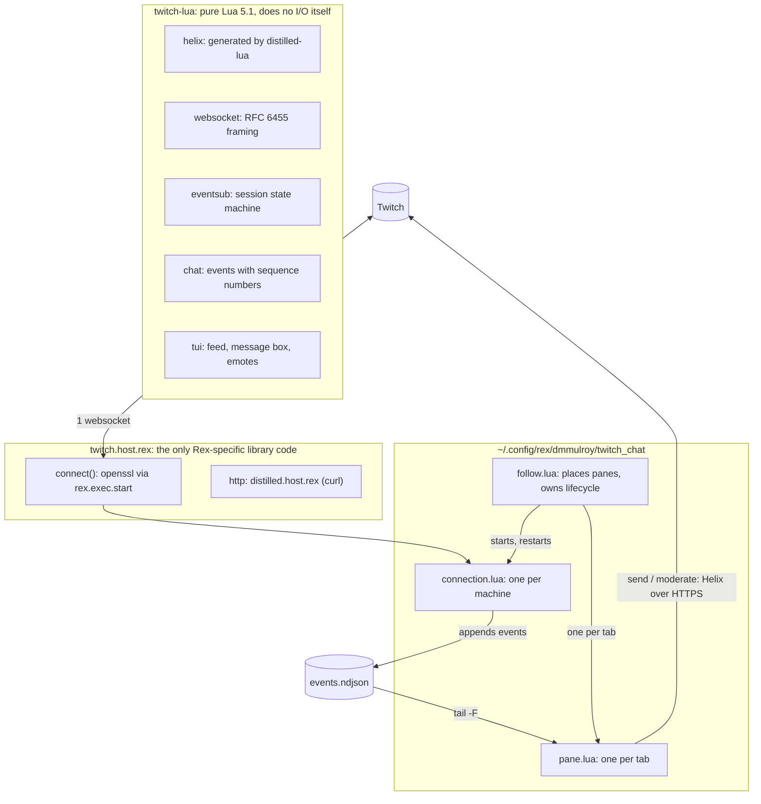
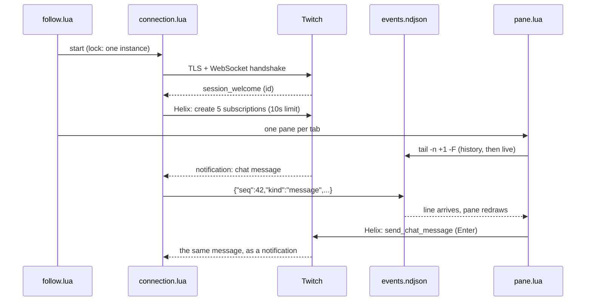
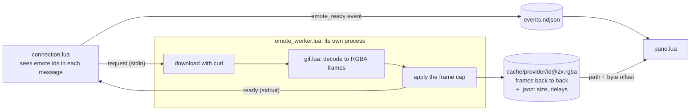

# Native Lua Twitch chat for Rex: design

Status: design only. Nothing here is built except the spikes in this folder.
Today's chat still runs on the twt fork (`dmmulroy/twitch-tui-fork`): one
`twt --serve` holding the Twitch connection and one `twt --attach` per tab.

## Goal

Replace twt with a pure-Lua Twitch library plus a thin Rex layer:

- one Twitch connection per machine, however many tabs and sessions are open
- a chat pane in every tab with its own size, scrollback and message box
- no Rust fork to maintain

## What was tested

Each of these was run for real before it went into the design.

| Claim | Result |
| --- | --- |
| A WebSocket client in Lua can reach Twitch from Rex | Works over macOS's built-in `openssl s_client`, driven by `rex.exec.start`. Ran 75 s: handshake, subscribe (HTTP 202), keepalives every 10 s, ping answered with a masked pong. |
| distilled-lua can generate a Twitch client | Distilled's OpenAPI converter turned the community Helix spec (`DmitryScaletta/twitch-api-swagger`) into a model with 147 operations. The generated client, trimmed to 11 operations, loaded in Rex in 33 ms and made real Helix calls. |
| A pane script can take keys without blocking | A helper reads the pane's tty in raw mode and Rex passes each keypress to a Lua callback. Timers kept running. `io.read` blocks timers, so it is not used. |
| One pane can show a feed and a message box | Prototype with a scrolling feed and a typed line on the bottom row held up while messages arrived every 0.5 s. |
| A pane can react to resizing | Rex sends `terminal.size_changed` with the new columns and rows (not in the docs, but it fired). |
| Panes can follow a shared log | `tail -n +1 -F` gave history then live lines, and replayed the file after it was replaced. |
| Rex can show a PNG from a file path | The Kitty graphics query for a PNG file returned OK. Twitch, BTTV and 7TV serve PNGs. |
| Animated emotes are available as GIF | Twitch, BTTV and 7TV all serve GIF (all 21 animated 7TV global emotes list one). FFZ's API did not answer. |
| GIFs can be decoded in pure Lua | `emotes/gif.lua` (287 lines) decoded 43 real emotes, 2,257 frames. Every pixel matched ffmpeg under lua, luajit and Rex. |
| Decoding is fast enough in Rex | 2.5 ms per frame. A typical emote (20 to 60 frames) takes 50 to 150 ms; the largest seen (492 frames) took 1.5 s. |
| Rex accepts frames, placeholders and animation commands | 360 of 360 commands answered OK, three runs: raw RGBA from a file, a frame at a byte offset inside a larger file, placeholders, and 112 add-frame commands. |
| A Lua timer can switch frames steadily | 25 ticks a second held for 8 s, about 0.4% CPU for 4 emotes. |

## Architecture



Sending does not use the websocket. Each pane calls Helix directly, and your
own message comes back through the feed like anyone else's.

## One connection, however many tabs

The earlier failure was Twitch's limit of 3 EventSub websocket connections per
account: every tab ran its own twt with its own connection, and the 4th was
refused with `429 Too Many Requests`.

In this design the number of tabs does not change the number of connections:

- Only `connection.lua` opens a websocket, and a lock file allows one
  `connection.lua` per machine. It holds 5 subscriptions on that one
  connection (the limit is 300, and these cost 0 against the account's budget).
- A pane never connects to EventSub. It reads the log file, and it sends with
  ordinary HTTPS calls to Helix, which do not count against the limit.

What can still reach the limit, and what happens then:

| Case | Result |
| --- | --- |
| Something else uses the same account's connections: a standalone twt, or this setup on a second machine | Each one is +1. Three in total still work. |
| A reconnect while Twitch still counts the old connection | Twitch answers 429 for a few seconds. Seen in testing. `connection.lua` waits and retries (1 s up to 60 s) and shows a status line; it does not exit. |
| `connection.lua` crashes | `follow.lua` restarts it. Panes keep running, show "reconnecting", and continue from the log. |
| A pane crashes | Only that pane is affected. `follow.lua` restarts it and it re-reads history from the log. |

The cost of many tabs is local only: each pane is one `rex do` process (21 to
43 MB measured) plus two small helpers. A twt pane is about 20 MB today.

## Layout

```text
twitch-lua/                      # new repo
├── lua/twitch/
│   ├── websocket.lua            # bytes in, frames out; builds handshake and masked pong
│   ├── eventsub.lua             # welcome, keepalive, reconnect, revocation; returns effects
│   ├── chat.lua                 # notification -> {seq, kind, ...}; delete and clear handling
│   ├── auth.lua                 # token source; validate at start and hourly (Twitch requires it)
│   ├── gif.lua                  # GIF -> RGBA frames; pure Lua, no I/O
│   ├── emote_cache.lua          # cache layout, frame cap, eviction
│   ├── tui/                     # feed.lua, input.lua, screen.lua, emotes.lua
│   └── host/rex.lua             # connect(), timers, guarded callbacks
├── clients/twitch/              # distilled-lua output, 11 operations
├── providers/twitch.lua         # bearer token + Client-Id header
└── spec/                        # recorded frames; runs under lua, luajit and rex

~/.config/rex/dmmulroy/twitch_chat/
├── init.lua                     # toggle action (unchanged)
├── follow.lua                   # pane command becomes `rex do pane.lua tty=$(tty)`
├── connection.lua               # wires eventsub + chat to the Rex host, writes the log
├── emote_worker.lua             # downloads and decodes emotes off the main scripts
└── pane.lua                     # wires tui to keys, log lines and resize events
```

## How it runs



The connection logic takes frames and clock ticks and returns what to do, so
it can be tested with recorded frames and no network:

```text
on text frame
  session_welcome    -> subscribe each type via Helix; status "joined"
  session_keepalive  -> reset the silence timer
  notification       -> chat:apply(event) -> append to log
  session_reconnect  -> open reconnect_url; on its welcome, close the old connection
  revocation         -> status line in the log
on ping              -> send masked pong
on close / silence longer than keepalive + 10s
                     -> reconnect, backoff 1s up to 60s, resubscribe
on Helix 401         -> status "token invalid", stop
on subscribe 429     -> another connection holds these subscriptions; back off, say so
```

Each pane is one script that never blocks on input:

```text
┌─────────────────────────────┐   keys    <- helper reading the pane's tty in raw mode
│ viewer1: hello              │   events  <- helper running tail -F on the log
│ dillon: half of a           │   resize  <- rex.on("terminal.size_changed")
│         wrapped line        │
├─────────────────────────────┤   every input updates state, then redraws the visible rows
│ > message being typed       │   Enter  -> helix:send_chat_message, or a /command
└─────────────────────────────┘   Ctrl-C -> exit 0 (follow.lua turns chat off, as `q` does now)
```

The pane keeps the last few hundred events in memory and redraws from them.
That gives scrollback, re-wrapping on resize and message deletion.

## Rules Rex imposes

All of these were tested.

| What Rex does | How the design handles it |
| --- | --- |
| An error inside an output callback is swallowed and stops all further output from that command | Every callback runs through one guarded wrapper that logs the error |
| Docs say a command started in a timer or handler is stopped when it returns (it survived in testing) | Helpers always start with `detach = true`, which the docs guarantee |
| Detached helpers survive the script; an orphaned `openssl` stayed connected for 40 s or more | Helpers run under a small shell guard; it exited within 4 s of the script being killed |
| `rex.on` only works at script load | Handlers register at the top; everything later uses timers |
| `rex.json.decode` drops `null` inside arrays | Decode with `distilled.json` |
| `pcall` can corrupt closures in gopher-lua (per distilled-lua's AGENTS.md) | Use `compat.pcall` from distilled |
| `io.read` blocks timers | Keys arrive through the raw-mode helper |
| Each Helix call blocks the calling script for about 0.4 s | Fine for sends; the connection script only calls Helix when (re)subscribing |
| The log gets replaced when compacted | `tail -F` replays the new file; panes skip sequence numbers they have seen |
| `for x in f().field:method() do` fails with "attempt to index nil" (works in stock Lua) | Put the value in a local first |
| An iterator returned by `gmatch` cannot be called by hand, only by `for` | Use `for`, or `string.find` in a loop |
| `debug.getinfo(1, "S").source` has no leading `@` | Strip an optional `@` before using it as a path |
| The tty holds only about 1 KB of unread terminal replies; the rest are dropped | Send graphics commands with `q=2` (no replies). When a reply is needed, the raw-mode reader is running first |

## Token

twt on macOS reads `~/Library/Application Support/com.twitch-tui.twt/config.toml`.
That token does not expire and has the chat and moderation scopes.
`~/.config/twt/config.toml` is a stale copy from April whose token cannot
subscribe to chat (Twitch answers 403).

## Not verified, and what you would give up

- **What Rex draws for emotes.** Rex accepted every command, and twt's panes
  hold placeholder cells in Rex today, but replies do not say what is on
  screen. `emotes/emote_demo.lua` shows it in one run (see "Animated emotes").
- **FFZ animated emotes.** Their API did not answer, so their format is
  unknown. If they have no GIF, they show as a still image.
- **Text edge cases.** Wide characters, emoji widths and pasted text are not prototyped.
- **Busy chats.** Frame parsing is per byte in Lua. Fine for a small channel;
  not measured at hundreds of messages a second.
- **The Helix spec is unofficial** and its repo has no licence file. That
  matters if the generated client is published.
- **Missing compared with twt:** emote picker, search and the channel
  dashboard. These could be added later in Lua.

## Animated emotes

No WebP decoder is needed: every provider checked serves animated emotes as
GIF. Static emotes stay PNG, which the terminal decodes itself.



- **Decoding** is `gif.lua`: LZW, local and global color tables,
  transparency, the three disposal modes, interlacing and frame delays. It
  takes bytes and returns frames, so it is tested without Rex. Interlacing is
  written but untested: none of the 43 sample emotes use it.
- **The worker is a separate process** because a large emote takes over a
  second to decode, and a pane or the connection must not stall that long.
  `connection.lua` starts it and talks to it over stdin and stdout.
- **One cache file per emote**, shared by every pane. A pane never reads the
  pixels: it gives the terminal the file path and each frame's byte offset.
- **Until an emote is ready** the pane shows its name as text. The
  `emote_ready` event makes panes redraw the rows that contain it.
- **Third-party emotes** (BTTV, 7TV, FFZ) are plain words in a message. The
  worker fetches the channel's emote lists at join and writes a name-to-emote
  map that panes use while drawing.

Two ways to animate, both built into the pane:

| | The terminal plays the frames | Lua switches the frames |
| --- | --- | --- |
| How | One image per emote. Every frame is added to it with its delay, then the terminal is told to loop (what twt does). | One image per frame. A 40 ms timer works out each visible emote's current frame from the clock and rewrites only those cells when it changes. |
| Ongoing cost | None in Lua | About 0.4% CPU for 4 emotes at 25 ticks a second |
| Tested | Rex answered OK to all 112 add-frame commands. Whether it advances frames on screen is not known. | The timer and redraws ran steadily. Whether Rex repaints the cells is not known. |
| Control | The terminal animates everything, always | Lua can pause when the pane is not focused, or cap the frame rate |

The pane has a setting, `animation = "terminal" | "lua" | "off"`. The default
depends on what the demo shows on screen:

```sh
rex do "$TMPDIR/twitch-lua-spike/emotes/emote_demo.lua"
```

Row 1 is a still frame, row 2 uses the terminal, row 3 uses the Lua timer. If
row 2 moves, the terminal method is the default because it costs nothing. If
only row 3 moves, the Lua method is.

Limits, so one emote cannot hurt a pane:

| Limit | Value | Why |
| --- | --- | --- |
| Scale | 2x (56 px for Twitch) | Sharp at one row high on a Retina display |
| Frames per emote | 120, and 4 MB of RGBA | The 492-frame emote would be 9.6 MB. Over the cap, keep every 2nd or 3rd frame and give it the dropped frames' time. |
| Frame rate with the Lua method | 25 a second | Some emotes ask for 50; the clock decides the frame, so skipped ticks do not slow the loop |
| Images held by a pane's terminal | Emotes on screen or in the pane's buffer; least recently used are deleted | Bounded terminal memory |
| Disk cache | Least recently used files removed over a size cap | Bounded disk use |

## Build order

1. `websocket.lua` and `eventsub.lua` with recorded-frame tests.
2. Add a `twitch` model for distilled-lua; generate and vendor the client.
3. `host/rex.lua` and `connection.lua`, writing the log. Check with `tail -f` in a terminal.
4. `tui` and `pane.lua` with text only; switch `follow.lua` over. twt stays installed as the fallback.
5. Emotes: still images first, then `emote_worker.lua`, the cache and both
   animation methods. `gif.lua` is already written and checked.

Steps 1 to 4 are roughly 1,500 to 2,000 lines of Lua plus tests. Step 5 adds
about 700 more, of which `gif.lua` is 287.

## Spikes in this folder

| File | What it shows |
| --- | --- |
| `websocket_over_openssl.lua` | WebSocket client over `openssl`, with the guard that stops orphaned helpers |
| `providers_twitch.lua` | distilled-lua provider spec for Helix |
| `distilled_convert_twitch.ts` | Distilled convert script for the Helix OpenAPI spec |
| `rex_callback_semantics.lua` | What Rex does with errors, nested calls and helpers inside callbacks |
| `kitty_png_query.lua` | Asking Rex whether it can load a PNG by path |
| `resize_event.lua` | The `terminal.size_changed` event |
| `tail_follow.lua` | Following a log that is appended to and replaced |
| `emotes/gif.lua` | The GIF decoder |
| `emotes/compare.lua`, `emotes/rex_decode.lua` | Check the decoder against ffmpeg's frames (`ffmpeg -i x.gif -fps_mode passthrough -f rawvideo -pix_fmt rgba`), in stock Lua and in Rex |
| `emotes/kitty_frames.lua` | What Rex's terminal answers to each graphics command |
| `emotes/emote_demo.lua` | The same four emotes still, played by the terminal, and switched by Lua |
| `emotes/samples/` | The 43 real emote GIFs used |

This folder is under `$TMPDIR` and will be lost on reboot.
