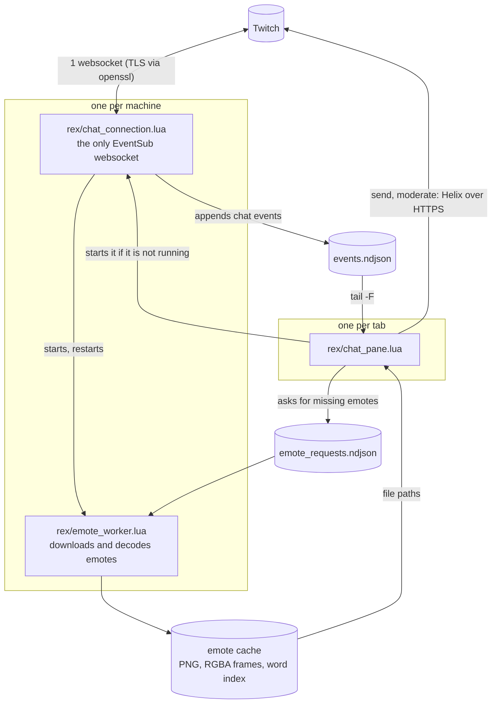

# How twitch-lua works

Twitch chat for Rex in Lua: one Twitch connection per machine, a chat pane in every tab
with its own size, scrollback and message box, and emote images including animated ones.

## Processes



Sending does not use the websocket. A pane calls Helix, and its own message comes back
through the event log like anyone else's.

## Why the number of tabs does not matter

Twitch allows 3 EventSub websocket connections per account, and refuses the next
subscription with `429 Too Many Requests`. One chat program per tab ran into that at the
fourth tab.

- Only `chat_connection.lua` opens a websocket, and a lock file allows one of it per
  machine. It holds 5 subscriptions on that connection (the limit is 300 and these cost
  nothing against the account's budget).
- A pane never connects to EventSub. It reads the event log and sends with ordinary HTTPS
  calls, which do not count.

What can still reach the limit:

| Case | Result |
| --- | --- |
| Something else uses the account's connections: another chat program, or this on a second machine | Each one is +1. Three in total still work. |
| A reconnect while Twitch still counts the old connection | Twitch answers 429 for a few seconds. The connection waits and retries (1 s doubling to 60 s) and says so in the feed; it does not exit. |
| The connection process dies | A pane starts a new one within 5 seconds. Panes keep running. |
| A pane dies | Only that pane is affected. |

## The connection

`eventsub_connection.lua` is driven by an injected host (a byte stream, timers, a clock),
so the specs run it against a scripted server with a manual clock.

```text
open the stream, write the websocket handshake
on text frame
  session_welcome    -> create the 5 chat subscriptions through Helix (Twitch gives 10 s)
  session_keepalive  -> resets the silence timer (every message does)
  notification       -> chat event -> event log
  session_reconnect  -> open the URL Twitch gave; when that connection is welcomed, close
                        the old one; subscriptions carry over
  revocation         -> a warning; "authorization revoked" stops for good
on ping              -> masked pong
on close frame, stream end, or silence longer than the keepalive timeout + 5 s
                     -> reconnect after 1 s, doubling to 60 s; the delay resets after a
                        minute of being joined
on subscribe: 401 -> stop ("token invalid")   403 on chat messages -> stop ("needs user:read:chat")
              429 -> retry later              409 -> already subscribed, fine
```

After a token problem the connection stays up and looks at the token file every 30
seconds, so replacing the token is enough. It validates the token with Twitch at start and
every hour, as Twitch requires.

TLS is `openssl s_client -verify_return_error -verify_hostname` run as a helper process.
macOS's `/usr/bin/openssl` is LibreSSL and has no hostname check (measured: it accepted
`wrong.host.badssl.com`), so a Homebrew OpenSSL is required and the connection refuses to
start without one.

## The event log

One JSON object per line with a rising `seq`:

```json
{"seq":42,"at":1795016551,"kind":"message","id":"…","name":"Viewer","color":"#5B99FF","text":"hi Kappa","parts":[{"type":"text","text":"hi "},{"type":"emote","text":"Kappa","emote_id":"25"}]}
```

Kinds: `message`, `notice` (subs, raids), `delete`, `clear`, `clear_user`, `status`.
Panes follow it with `tail -n +1 -F`: history first, then live. Past 2,000 lines it is
replaced with its last 500; `tail -F` replays the new file and panes skip the sequence
numbers they have seen.

## The pane

`tui/chat_pane.lua` takes key bytes, event log bytes and size changes, and writes the
screen through one `write` function, so the specs run it against a small fake terminal.

```text
rows 1..n-2   the feed, newest at the bottom, word-wrapped to the pane's width
row  n-1      status bar: channel, connection, "↓ 3 new" when scrolled up
row  n        the line being typed
```

- Keys come from a helper that puts the pane's terminal in raw mode; Rex passes each
  chunk to a Lua callback. `io.read` is not used: it blocks timers.
- Every redraw is absolute: each row is cleared and rewritten inside a synchronized
  update, with line wrapping off. A width the cell table gets wrong can cut a row short
  but cannot push other rows around.
- Chat text is untrusted. Control characters (including ESC) and invalid UTF-8 are
  removed before layout, so a message cannot send escape sequences to the terminal.
- Width is counted per grapheme cluster: combining marks and joiners add nothing, CJK
  and emoji take two cells.

## Emotes

No WebP decoder is needed: Twitch, BTTV and 7TV serve animated emotes as GIF. Still
emotes are PNG, which the terminal decodes itself. FFZ emotes are shown as still images
(their global set has no animated ones; their channel sets were not checked).

- **`gif_decoder.lua`** decodes a GIF to RGBA frames: LZW, global and per-frame color
  tables, transparency, the three disposal modes, interlacing, frame delays. It was
  compared with ffmpeg on 43 real emotes (2,257 frames): every pixel equal, under lua,
  luajit and Rex. The specs keep four of those emotes and test each feature on small
  generated images. It never raises, whatever the bytes are.
- **The worker** is its own process because decoding in Rex takes about 2.5 ms a frame
  (1.5 s for the largest emote seen, 492 frames). It builds URLs itself from a provider
  and an id made only of letters, digits, `_` and `-`; a request cannot name a URL or a
  path.
- **The cache** holds, per emote, a small JSON file plus either the PNG or all frames back
  to back as raw RGBA. A pane never reads pixels: it gives the terminal the file's path
  and each frame's byte offset.
- **Limits**: an animation keeps at most 120 frames and 4 MB; past that every n-th frame
  is kept and takes over the dropped frames' time. A pane's terminal holds at most 48 MB
  of images; emotes off screen are unloaded first. The disk cache is cut back past 256 MB.
- **Until an emote is ready** its name is drawn as text. Panes look for emotes they asked
  for twice a second and redraw when one arrives.
- **Third-party emotes** are plain words in a message. The worker fetches the channel's
  BTTV, 7TV and FFZ lists in the background (they can take 15 seconds or more), writes a
  word index as each arrives, and retries a list that failed.

Animation, set by `animation` in the settings:

| | `terminal` (default) | `lua` | `off` |
| --- | --- | --- | --- |
| How | One image; every frame is added with its delay and the terminal loops it | One image per frame; a 40 ms timer works out the current frame from the clock and the pane redraws when it changes | First frame only |
| Cost while running | None in Lua | About 0.4% CPU for 4 emotes (measured) | None |

Both `terminal` and `lua` were seen animating in Rex. Rex's terminal answered OK to every
command in all three modes (`spec/rex_emote_terminal_check.lua`).

## What Rex's Lua needs

All measured; each is handled where noted.

| What Rex does | How it is handled |
| --- | --- |
| An error inside an output callback is swallowed and stops that command's output for good | Every callback goes through `host.guard`, which logs the error |
| A command started in a timer or handler must be detached to outlive it, and a detached command outlives the script (an orphaned `openssl` stayed connected for 40 s or more) | Every helper is detached and tied to its owner: it reads stdin and stops at end of input, or runs under a small wrapper that watches the stdin pipe |
| `rex.exec.start` has no exit callback | One timer polls the helpers |
| Output callbacks never run during `rex.sleep` or a blocking wait | The pane and the connection only use timers; only the worker sleeps |
| `rex.on` only works at script load | Handlers register at the top level |
| `pcall` can corrupt closures | `compat.pcall` from distilled-lua |
| `tonumber(nil)` and `tostring()` of no value raise | A fallback before the call |
| `a, b = f(x), y` assigning to existing variables crashed with a nil pointer dereference in one function | Two statements there, with a comment |
| `for x in f().field:gmatch(...)` fails with "attempt to index nil" | The value goes in a local first |
| `debug.getinfo(1, "S").source` has no leading `@` | An optional `@` is stripped |
| A `rex do` script sent SIGTERM or SIGINT exits with status 130 | Whoever watches a pane treats 130 as "it was asked to stop" |
| The tty holds about 1 KB of unread terminal replies and drops the rest | Graphics commands are sent with `q=2` (no replies) |
| `rex.json.decode` drops `null`, also inside arrays | Wanted here; the pure-Lua fallback does the same |

## Not covered

- Sending a message to a live chat was never run by the tests; the Helix call was checked
  with a request Twitch rejects (an empty message).
- Badge images, an emote picker, search, and a channel switcher are not there.
- Very busy chats: frame parsing is per byte in Lua and was not measured at hundreds of
  messages a second.
- FFZ animated emotes show as still images.
